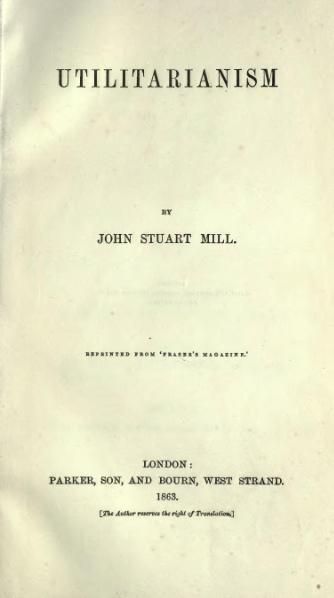

# Utilitarianism

- `Author`: John Stuart Mill
- `Year`: 1863
- `Link`: [Project Gutenberg](https://www.gutenberg.org/ebooks/11224)



> 주의: 요약과 문장 번역을 제 마음대로 하기 때문에 부정확할 수 있습니다.

글을 하나 쓰는데 배경지식으로 필요해서 읽었다.

원문으로 읽어보니 느낀 게 많다. 우선 저자가 뭔가 쌓인 게 많은 것 같다. 초반에 여러가지 비판들을 쳐내는 말투에서 상당한 빈정거림이 느껴진다. 그리고 공리주의에 대해서 몰랐던 뉘앙스가 상당히 많음을 알게 됐는데... 읽다 보니 오히려 뉘앙스가 너무 많아서 갈피를 잡기 어려웠다. 부분부분마다 말하는 것들이 충돌하는 것 같기도 하고, 방향이 다른 것 같기도 하고... 다 읽으니 오히려 머릿속에서 정리가 잘 안 되는 느낌이었다.

영어 문장 독해력이 많이 나아졌다. 이해하는 데 제일 오래 걸린 문장을 가져와 봤다.

> That which is the result of habit affords no presumption of being intrinsically good; and there would be no reason for wishing that the purpose of virtue should become independent of pleasure and pain, were it not that the influence of the pleasurable and painful associations which prompt to virtue is not sufficiently to be depended on for unerring constancy of action until it has acquired the support of habit. (4장)

## 1. GENERAL REMARKS

옳고 그름의 문제는 어렵다. 예를 들어 과학의 가장 기본이라 여겨지는 원리들도 사실 관찰 끝에 추론으로 나온 것들이지 완전무결한 진리가 아니다. _(개별적인 사실들 -> 일반적인 이론)_

윤리학에서는 위 화살표가 반대방향으로 갈 수 있을까? 즉, **옳고 그름에 관한 일반적인 원리를 먼저 세우고, 그에 따라 개별적인 행동 사례가 옳은지 그른지 판단할 수 있을까?**

옳고 그름의 원리는 사람들이 태어날 때부터 직관적으로 알고 있다는 설(intuitive school)이 있고, 관찰과 경험을 통해 배우게 되는 것이라는 설(inductive school)이 있다. 둘 모두 **도덕이란 일반적인 원리에서 비롯되어야 한다**는 데에는 동의를 한다. 하지만 지금까지 그 일반적인 원리가 뭔지 확실히 설명하려는 노력은 적었다.

---

`주장` **윤리학에 가장 근본이 되는 단 하나의 원리가 있어야 한다.** 혹은, 근본이 되는 원리가 많다면, 그 중 무엇이 선행되어야 하는지 **순서**가 정해져 있어야 한다. (원리들이 서로 충돌하는 상황이 온다면 그 중 무엇을 적용할지 알려주는 순서)

> _자이: 이 부분에서 저자는 이미 가정을 하나 깔아 놓은 것 같다. 어떤 상황에서 취할 수 있는 행동의 선택지가 여러 개 존재한다면 그 중 "**가장 좋은 행동**"을 정의할 수 있다는 가정이다. (정확히는, 다른 어떤 행동보다도 나쁘지 않은 행동)_

도덕의 원리가 뭔지 정확히 쓴 이는 드물지만, 그래도 암묵적으로 옛부터 있었던 원리가 있다. 그것을 말로 설명한 게 **공리**(utility)의 원리, 즉 벤담의 **최대 행복 원리**(greatest happiness principle)이다. 어떤 구체적인 행동이 사람들의 행복에 미치는 영향이 중요하다는 건 모든 윤리학자들이 동의할 것이다.

---

`주장` **공리**의 원리를 빼놓고 윤리학을 세우기는 힘들다.

예를 들어 **칸트**는 <도덕형이상학>에서 "**모든 이성적 존재들이 법으로 받아들일 수 있을 만한 것**을 당신의 행동 원리로 삼아라."라는 원칙으로 윤리학을 세우려 했다. 하지만 "특정 이기적인 행동은 어째서 모든 이성적 존재들이 법으로 받아들일 수 없는 것이냐" 질문한다면 대답이 어렵다. 그런 행동 원리를 받아들였을 때 일어나는 결과가 모두가 원치 않는 결과일 것이라서? 그렇게 묻다 보면 결국 "공리"의 개념이 필요하게 된다.

이 책은 **공리주의의 타당성**에 대해 논할 것이다. 단, "**행복은 왜 좋은가?**" 같은 질문까지 간다면 그걸 직접 증명하는 건 불가능할 것이다. 어떤 개념은 그냥 그 자체로 좋은 것이라 가정해야 할 수 있다. (물론 그런 가정이 충분히 납득되도록 설명은 해 보겠다)

공리주의가 옳은지 그른지 논하기 전해 공리주의를 제대로 이해해야 한다. 공리주의에 대해 퍼져 있는 오해만 풀더라도 이 논쟁의 많은 부분은 해결될 것이다.

## 2. WHAT UTILITARIANISM IS

### 질적 공리주의의 이해

우선 공리주의가 모든 걸 무미건조하게 쓸모(이것도 영어로 utility) 기준으로 판단한다고 까는 사람, 또는 저급하게 쾌락 기준으로 판단한다고 까는 사람들이 있다. 둘 다 바본데 계속 보다 보니 둘이 똑같은 부류 같다. 철학책을 한 번이라도 읽어봤으면 **공리**라는 게 곧 **쾌락**이며 **고통의 부재**를 뜻한다는 건 알 것이다.

> _자이: 원래 책 말투보다 많이 순화됐다_

공리주의에서 모든 행동은 그게 **행복을 증진하는 정도**에 비례하는 만큼 올바르다고 하고, **불행을 유발하는 정도**에 비례하는 만큼 그릇되었다고 한다. 행복이란 **쾌락, 그리고 고통의 부재**다. 이것만이 어떤 행동을 하는 목적으로서 바람직하다. 즉, 모든 윤리적으로 바람직한(desirable) 행동은 그 자체에 내재된 쾌락 때문에 바람직한 것이거나, 그 행동이 쾌락을 증진하고 고통을 방지하기 때문에 바람직하다.

자, 그럼 당연히 싫어하는 사람이 나온다. "어떤 긍지도 없이 겨우 **쾌락**을 느끼는 게 삶의 목적이라는 것이냐?" 옛날에 쾌락주의자라 오해받던 에피쿠로스학파는 이에 이렇게 반박했다. 인간은 저급하게밖에 쾌락을 못 느낀다고 생각하는 것이야말로 인간에 대한 모독이라고. 공리주의자들도 지금까지 물질적인 쾌락에 비해 **정신적인 쾌락**을 중요시하긴 했다.

`주장` 이전 공리주의자들은 정신적인 쾌락이 더 바람직한 이유를 ‘더 지속적이기 때문에, 더 안전하기 때문에‘ 등으로 이야기했다. 그러나 더 간단하게 이렇게 설명할 수도 있다. **쾌락에 따라 질의 차이가 있고**, 한 종류의 쾌락이 다른 종류의 쾌락에 비해 더 바람직할 수 있다고.

그렇다면 어느 쾌락이 더 바람직한지는 어떤 원리로 정해지는가?

`주장` 두 종류의 쾌락을 **모두 느껴 본 사람들**이 비교했을 때 전부 혹은 대다수가 **한쪽을 더 선호**한다면, 그것이 더 바람직한 쾌락이다. 다른 쪽 쾌락이 얼마나 있든 한쪽을 더 선호한다면 곧 쾌락의 양은 중요치 않을 정도로 한쪽 쾌락의 질이 높은 것이다.

> _자이: 여기서 아까 나온 가정이 더 구체적으로 드러난다. 쾌락의 선호에는 "**가위바위보 관계**"는 **없다**는 가정이다. `A, B, C`라는 3가지 종류의 쾌락이 있을 때, 가위바위보 관계처럼 A가 B를 이기고, B가 C를 이기는데 C가 A를 이기는 경우는 없을까?_
>
> _이건 간단한 문제가 아니기 때문에, 그런 경우가 없다고 주장하려면 근거가 더 필요하다._

`주장` 인간은 누구든 짐승의 쾌락보다는 **인간의 고등한 능력과 연관된 쾌락을 선호**한다(둘을 모두 경험해 보았다면). 짐승의 쾌락을 전부 준다고 해도 그 고등한 쾌락을 포기할 사람은 없다. 만약 있다면 필시 현재 너무나 큰 불행 속에 있어서 무엇이든 포기할 수 있는 사람일 것이다.

인간이 하등한 쾌락만 느끼며 살지 않으려는 이유는 한 마디로 **존엄성**(dignity)이라 표현할 수 있다. 존엄성은 인간의 행복에 너무 중요하여, 특히 존엄성을 중요시하는 사람이라면 그와 충돌하는 쾌락은 일시적인 게 아니고서야 바랄 수 없다.

인간의 존엄성을 지키는 것은 행복을 희생하는 게 아니다. 행복과 **만족감**은 다르다. 행복의 기준이 낮은 존재는 쉽게 만족하겠지만, 우리는 행복의 기준이 높은 존재라 완벽히 만족하기 어려운 것뿐이다.

> It is better to be a human being dissatisfied than a pig satisfied; better to be Socrates dissatisfied than a fool satisfied.

> _자이: 저자는 인간이 이러하다고 믿어서 이렇게 쓴 걸까?_

---

### 공리주의에 대한 흔한 오해들

**비판 1**: 사람들은 유혹에 이끌려 **저급한 쾌락**도 좇지 않나?

**답**: "뭐가 더 좋은 쾌락인지 알면서" 더 질 낮은 쾌락을 **일시적으로** 좇은 거다. 질 낮은 쾌락이 질 높은 쾌락이 되는 게 아니다.

---

**비판 2**:  어떤 사람이 나이 들고 게으르고 이기적으로 변했다. 이 사람은 **지속적으로** 게으름과 이기성에서 오는 쾌락을 좇는데 그럼 이 사람한테는 그게 더 좋은 쾌락인가?

**답**: 그 사람은 질 낮은 쾌락을 원해서 좇은 게 아니라, "더 질 좋은 쾌락의 추구를 이미 못하게 된 것". **고결함**(nobleness)을 좇을 수 있는 여유는 **주변 환경이나 사회가 허락하지 않는다면** 쉽게 사라질 수도 있다.

---

두 쾌락 중 무엇이 더 바람직한지는 **두 쾌락을 모두 경험한 이들의 다수결**이 결정한다. 직접 경험한 자들의 판결 외에 무슨 쾌락의 양에 대한 논의가 필요하겠는가?

> _자이: 다수결이 나온 김에, 아까 저자가 암묵적으로 세운 가정에 있는 문제를 보자._
>
> _세상에 세 종류의 쾌락 A, B, C가 있고, 이를 경험한 사람 5명이 그에 대한 선호도를 다음과 같이 매겼다고 하자._
```
가 A > B > C
나 A > B > C
다 C > A > B
라 C > B > A
마 B > C > A
```
> _그러면 어떻게 될까? 알파벳 두 개씩 비교해 보자._
```
A와 B 중 무엇이 더 선호되는가?
B와 C 중 무엇이 더 선호되는가?
C와 A 중 무엇이 더 선호되는가?
```
> _확인해 보면 가위바위보 관계가 생긴다._
>
> _일반적으로 선택지가 3개 이상일 때는 "2개씩 비교해서 우승자를 고르는 방법"이란 것이 따로 존재하지 않는다._

---

**비판 3**: 고결한 행동이 행동한 사람 **자신을 행복하지 않게** 하는 경우도 있지 않나?

**답**: 지금까지는 한 개인에 초점을 맞춰 그 사람이 느끼는 행복과 쾌락에 대해 설명했는데, 공리주의에서 좋은 행동의 기준이 되는 건 '**모두의 행복의 합**'이다. 그렇다면 개개인의 고결한 성격을 길러주는 것은 사회적으로 더 중요하다. 고결한 행동이 행동한 사람 자신을 설령 행복하지 않게 한다 해도 그 행동이 다른 사람들의 행복을 높이는 것은 분명하기 때문이다.

---

**비판 4**: 행복은 실재하지 않는다. 행복은 얻을 수 없는 것이다. **행복을 포기**하고 금욕적으로 사는 것이 모든 덕의 시작이다.

**답**: 행복의 실재를 인정하지 않더라도, **불행을 줄인다는** 측면에서의 공리주의는 인정할 수 있을 것이다. 근데 행복을 얻을 수 없다는 건 과장 아니냐? 매 순간 쾌락을 느끼면서 평생 사는 건 당연히 불가능하겠지만, **여러가지 쾌락을 때때로 느낄 수 있는 삶이라도** 행복이라 부를 수 있는 것 아니냐.

---

**비판 5**: 행복을 삶의 목적이라고 설정한다면, 각 개인이 지금 정도로 적은 행복으로 **만족할 수 있을까?**

**답**: 이미 만족하며 사는 사람들이 있다. 만족하게 해 주는 요소는 두 가지, **평정심**(tranquility)과 **감흥**(excitement). **평정심**은 적은 양의 행복으로도 만족할 수 있게 해주고, **감흥**은 많은 양의 불행을 견딜 수 있게 해준다. 누군가가 자기 행복에 만족하지 못한다면 그것은 **이기심**(selfishness) 때문이거나, 또는 그 사람이 자기 **정신의 고양**(mental cultivation)을 원해서 현재에 만족하지 않고 있기 때문일 것이다.

---

`주장` 우리가 행복한 삶을 좇지 못하게 만드는 세상의 크고 작은 문제들은(가난, 질병 포함) **해결 못하는 필연적인 것들이 아니다**. 사람들은 환경이 허락한다면 반드시 질 높은 행복을 좇는 삶을(사회에서 지적이고 윤리적인 것들을 인간으로서 누리는 "**부러워할 만한 삶**"을) 선택할 것이다.

세상 사람들의 대부분은 행복을 누리지 못하고 산다. 그 중에는 대의를 위해 **스스로 행복을 포기하고 사는 영웅**들도 있다. 그런데 이 대의란 것도 다른 사람들의 행복을 뜻하는 것이 아닌가? 다른 무언가의 덕을 위해 자기희생을 한 것이 아니고, **인류의 행복을 증진시키기 위해 한 행동이라서** 칭찬받아 마땅한 것이다.

행복의 증진을 위해서 자기희생을 해야 하는 상황이 나온 것은 우리가 현재 몹시 **불완전한 세상에 살고 있기 때문**이지만, 그래도 공리주의에서는 다른 사람의 선을 위해 자신의 선을 희생하는 행위의 가치를 인정한다. 자기희생 자체가 가치있는 게 아니고, **오로지 행복의 총합을 증진시킬 때에만** 그러하다. 공리주의에서는 자신의 행복과 타인의 행복을 마치 **제3자처럼 공평하게 비교**할 것을 요구한다. "이웃을 자신처럼 사랑"하는 기독교적 원리와 같다. 이러한 원칙이 지켜지는 이상에 도달하기 위해서 사회적으로 **법과 교육제도를 정비**하는 노력이 필요하다.

공리주의에서는 세상 전체의 행복을 중요시하지만, 세상 전체에 대해 의무감을 느끼며 모든 행동을 하라도 이야기하지는 않는다. 공리주의에서는 좋은 행동이기만 하면 **행동의 동기는 상관없다**. 그러니 자기 행동이 누군가의 권리를 침해하는 게 아니라면, 대부분의 경우 자기와 자기 주변에 당장 있는 사람들을 위해, 즉 **사적인 공리**(private utility)를 위해 행동해도 된다.

---

**비판 6**: 공리주의는 **결과만 중요시**하기 때문에 행동을 한 동기, 행동을 한 사람이 가진 여러가지 자질은 무시된다. 너무 드라이하다.

**답**: 공리주의라고 해서 행동의 옳고 그름 외에 사람이 가진 자질이 무시되는 건 아니다. "행동의 옳고 그름을 평가할 때는" 그러는 것일 뿐이다. 누가 그 행동을 했는지가 옳고 그름에 영향을 미쳐선 안 되니까. 공리주의에서도 전체의 행복이라는 덕 외에 **다른 가치가 존재함을 인정**하고, 그 가치를 추구하는 것을 막지 않는다. 물론 공리주의자들 중에서 행동의 윤리성에 너무 치중해 나머지를 소홀히 다룬 사람들도 있는 건 사실이다.

---

**비판 7**: 공리주의는 **신**을 인정하지 않는다.

**답**: 이는 오해로, 신의 도덕성을 어떻게 해석하냐에 달려 있다. 신이 모든 피조물의 행복을 바라고, 그것이 창조의 목적이라고 해석한다면 공리주의는 무엇보다 종교적인 교리가 된다.

---

**비판 8**: 행동 하나하나를 하기 전에 매번 인류 전체의 행복에 미칠 영향을 **계산할 시간이 없다**.

**답**: 계산할 시간은 **인류 전체의 역사**만큼 있었다. 경험을 통해 행동의 결과의 경향성을 파악하고, 우리가 법을 만든 것처럼 행동 원칙을 만들어가면 된다. 물론 그 원칙은 당장 완성될 수 없는 것이고, **무한히 발전시켜나가야 하는 것**이다. 공리주의의 제1원칙은 전체의 행복이지만, 얼마든지 세부적인 원칙들을 만들어나가며 윤리를 발전시킬 수 있다.

---

**비판 9**: 공리주의자들은 분명 자기한테 유리한 상황에서는 "이렇게 하는 게 공리를 증진시키는 일이다" 하면서 이기적인 행동을 할 것이다.

**답**: 이건 공리주의의 문제가 아니라 그냥 어떤 주의든간에 그 사람의 문제다. 어떤 윤리 체계든 여러가지 예외적인 상황이 있어서 그럴 때 이기적인 사람들이 요리조리 빠져나가려 하는 걸 막기가 쉽지 않다. 모든 일에 기준을 적용하는 건 어렵지만, 그래도 기준이 없는 것보다는 나을 것이다.

## 3. OF THE ULTIMATE SANCTION OF THE PRINCIPLE OF UTILITY

공리주의를 따를 이유는 무엇인가? 그 의무가 어디에서 나오는가?

어떤 도덕 체계를 따라야 하는 이유에는 보통 **외적**인 이유와 **내적**인 이유가 있다. 둘 다 문제 없이 공리주의에 적용될 수 있다.

**외적**인 이유란 신이나 다른 사람들 등을 위해 따르는 것이다. 공리주의에 적용하자면, 다른 사람들의 행복을 위해, 또는 신이 모든 사람의 행복을 바란다고 생각하고 신을 위해 따르는 경우이다.

**내적**인 이유란 우리 마음에서 일어나는 어떤 감정, 양심 등을 따르는 것이다. 공리주의에 적용하자면, 공리를 위한 행동을 하지 않으면 양심의 가책을 느껴서 따르는 경우이다.

사람이란 공리를 위한 행동을 하지 않으면 무조건 양심의 가책을 느끼는가? 꼭 그렇지는 않다. 하지만 인간이 언제 그 양심의 가책을 느끼는지를, 교육을 통해서 공리주의와 가깝게 만들 수는 있을 것이다.

**예상 반론**: 그렇게 하면 너무 주관적이게 되는 거 아닌가? 도덕적인 원리는 뭔가 초월적인 진리에 기반해야 하는 거 아닌가.

**답**: 어쨌든 사람이 느끼는 의무감이라는 것 자체는 마음에 있는 거니까. 기반이 되는 진리가 없으면 의무감이 쉽게 사그라드는 거 아니냐 걱정할 수도 있지만... 초월적인 진리를 믿든 안 믿든, 사람들이 자기 양심을 저버리는 행동을 하는 문제는 똑같이 생기는 것 같다.

---

**주장**: 양심의 가책 등 **도덕적인 감정**은 태어날 때부터 지니고 있는 건 아니고, 경험으로 획득하는 것이다. (다만 태어날 때부터 지니고 있다고 가정해도, 그 도덕적인 감정이 공리주의적인 것이 아닐 이유는 없다).

한 사람이 나고 자란 (대부분의) 문화와 사회적 관계 속에서, 그 사람은 다른 사람의 안녕에 관심을 갖는 법을 배운다. 자연스레 다른 사람의 안녕에 대해 생각하게 되고, 그걸 행동으로 옮기게 되고, 다른 사람들에게도 그런 생각을 권장하게 된다.

정치적 발전을 통해 불평등이 사라질수록 이러한 생각은 자연스러워지고 한 사람이 관심을 갖는 타인의 범위도 넓어질 것이다. 이러한 관점이 (마치 종교처럼) 사회적으로 퍼지고 어린 시절부터 교육된다면, (어떤 초월적 진리 없이도) 공리주의를 따라야 할 의무감이란 너무나도 당연해질 것이다.

물론 아직은 그러한 세상이 오지 않았지만, 지금도 사회적인 사람 누구나 자신과 타인이 조화를 이루길 원한다. 자신의 감정과 행동이 타인과 충돌하지 않도록, 타인의 선을 해치지 않도록 행동하려 한다. 이런 도덕 감정은 적어도 이들에게는 **자연스럽다**. 이 자연스러운 의무감이 곧 공리주의를 따라야 할 궁극적인 이유가 된다.

## 4. OF WHAT SORT OF PROOF THE PRINCIPLE OF UTILITY IS SUSCEPTIBLE

**오로지 행복만**이 목적으로서 바람직하다는 게 공리주의의 원칙이다. 이 원칙이 올바르다고 **증명**(또는 설득)할 수 있을까?

**주장**: "X가 보인다"를 증명하는 유일한 방법은 사람들이 X를 눈으로 보는 것이다. 비슷하게, "X가 바람직하다"를 증명하는 유일한 증거는 사람들이 실제로 X를 바라는 것이다.

사람들이 자신의 행복을 바란다는 것은 당연한 사실이다. 따라서 각자의 행복은 각자에게 있어 선하며, 모두의 행복은 모든 사람의 합에 있어 선하다.

즉 **행복**이 목적으로서 바람직하다는 건 증명되었다.

---

그렇다면 **오로지 행복만**이 목적으로서 바람직하다는 건 증명할 수 있을까?

일상적으로 쓰는 행복이란 단어를 생각해보면, 분명 사람들은 행복이 아닌 미덕 등을 바라기도 한다. 쾌락을 느끼고 고통을 피하는 것과 상관없는 미덕.

그러나 공리주의에서 말하는 **행복**은 매우 다양한 요소로 이루어져 있으며, 그 각각도 모두 **목적으로서 바람직하다**. 즉, 그것이 꼭 모두의 행복 총합을 증진하는 **수단**인지만 따져서 바람직함을 판단하는 게 아니고, 그것 자체로서 **목적**으로도 바람직하다는 것이다.

돈으로 비유하면 쉽다. 돈은 수단으로서 쓰이지만, 돈 자체를 사랑하는 것도 사람들이 가진 감정 중 하나이다. 즉 돈은 수단이면서 동시에 목적인 것이다.

원래는 행복을 얻기 위한 수단으로서 추구하던 무언가도, 추후에는 그 자체로 추구될 수 있다. 그렇다면 그 무언가는 행복의 일부로서 추구되는 것이다. 즉 그러한 것들 전체를 가리키는 말이 **행복**인 것이다.

이러한 관점에서는, 행복 이외에 사람이 바라는 것은 없다. 사람이 바라는 무엇이든 **행복이라는 궁극적인 목적을 위한 수단으로서 바라는 것이거나, 그 자체를 행복의 일부로서 바라는 것이다.**

---

위의 마지막 문장을 인정한다면 행복만이 목적으로서 바람직하다는 게 증명된 셈이다. 근데 저 문장의 근거는 어떻게 찾을까?

**주장**: "X를 바란다"와 "X를 Pleasant하게(Pleasure = 쾌락. "쾌락적으로"라 하겠음) 느낀다"는 같은 말이다. 또한 "X를 바라지 않는다"와 "X를 고통스럽게 느낀다"는 같은 말이다.

**예상 반론**: 사람은 무언가가 주는 쾌락이나 고통에 관계없이 다만 어떤 **의지**를 갖고서 행동을 할 수도 있지 않나? 의지는 욕망과 다르다.

**답**: 누군가가 자신의 쾌락을 낮추고 고통을 높이는 행동을 할 수도 있다는 것은 인정한다. 실제로 행동을 일으키는 의지와 그 사람이 느끼는 욕망은 다를 수 있다는 것도 인정한다.

하지만 이는 우리가 **습관**의 영향을 받는다는 것의 한 예시일 뿐이다. 적어도 처음에는, 모든 바람은 쾌락과 고통에서 비롯된다. 어떤 덕목을 지키는 행동이 쾌락적으로 생각되어야 그 행동을 비로소 시작할 수 있게 된다. **의지는 욕망의 자식**이며, 시간이 지나며 습관의 영향을 받게 됐을 뿐이다.

> Will is the child of desire, and passes out of the dominion of its parent only to come under that of habit.

올바른 일을 하려는 의지는 습관에서 독립시키는 것이 바람직할 것이다. 그러나 습관이란 행동을 확실하게 지속하기 위한 수단이다. 즉, 습관의 영향을 받는 의지는 그 자체로 선하다고 볼 수는 없지만, 선을 위한 수단으로 볼 수 있다. 이런 관점에서는 이것도 공리주의의 원리에 위배되지 않는다.

## 5. OF THE CONNEXION BETWEEN JUSTICE AND UTILITY

너무 길어서 일단안읽음 ㅎ